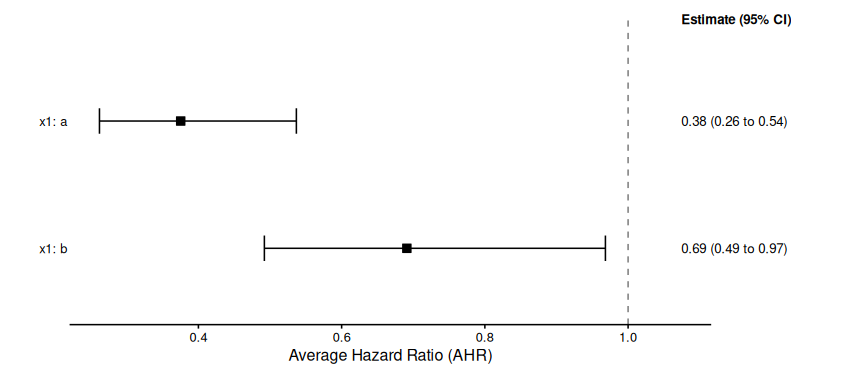
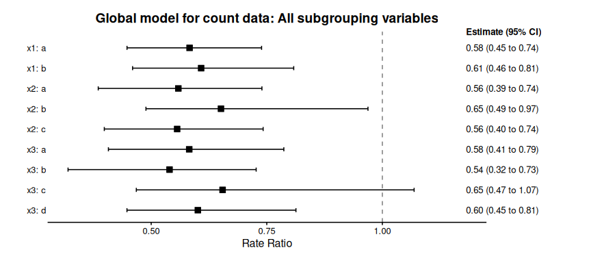

# Advanced Functionalities

This vignette demonstrates advanced functionalities supported by
`bonsaiforest2` and the underlying `brms` package, including
**customizing prior distributions for global shrinkage models**
(regularized horseshoe, normal priors with a common or with separate
heterogeneity parameters, R2-D2, and coefficient-specific priors),
**applying stratification** to nuisance parameters, and adding an
**offset to negative binomial regression models** for counts.

``` r

# Load packages and data
library(bonsaiforest2)
library(brms)
```

## 1 Customizing Prior Distributions for Global Shrinkage Models

In Bayesian analysis, the choice of priors is important and can
materially affect the results. For most settings, the `brms` default of
flat priors for the intercept (`intercept_prior`) and unshrunk terms
(`unshrunk_prior`, includes the prior for the main treatment effect) are
sensible and do not need fine-tuning. However, **we recommend that the
user carefully considers the prior for shrunken terms**, in particular
those for covariate-by-treatment interactions
(**`shrunk_predictive_prior`**).

`bonsaiforest2` gives the user full flexibility to specify priors as
described via examples below.

The **default priors** used by `bonsaiforest2` are as follows:

| Prior Component | Parameter Name | Default Prior |
|:---|:---|:---|
| **Intercept** | `intercept_prior` | `NULL` (i.e. `brms` default) |
| **Unshrunk Terms** | `unshrunk_prior` | `NULL` (i.e. `brms` default) |
| **Shrunk Prognostic** | `shrunk_prognostic_prior` | `horseshoe(scale_global = 1)`; in case the formula specifies random effects (pipe-pipe syntax), automatically uses a normal prior with a half-normal hyperprior with heterogeneity parameter 1 for the standard deviation instead |
| **Shrunk Predictive** | `shrunk_predictive_prior` | `horseshoe(scale_global = 1)`; in case the formula specifies random effects (pipe-pipe syntax), automatically uses a normal prior with a half-normal hyperprior with heterogeneity parameter 1 for the standard deviation instead |

The following examples demonstrate how to customize priors for **global
shrinkage models**, i.e. models which include treatment interactions
with all subgrouping variables (`x1`, `x2`, and `x3`) simultaneously.
Throughout, we use the same global model for the continuous outcome `y`
in `shrink_data` as in the Quickstart vignette, with `x1`, `x2`, and
`x3` as unshrunken prognostic terms, and only vary the prior for the
shrunken predictive terms. Strong shrinkage priors induce posterior
geometries that can be difficult to sample from, so we increase
`adapt_delta` to 0.99 (smaller sampler step sizes) to avoid divergent
transitions.

### Example 1.1: Global model with a regularized horseshoe prior

This is the global model from the Quickstart vignette: a regularized
horseshoe prior is applied to all treatment-by-subgroup interactions
`trt:x1`, `trt:x2`, and `trt:x3`. Its parameters are anchored in the
trial assumptions of a targeted treatment effect of
\\\delta\_{plan}=0.3\\ and a standard deviation of \\\sigma\_{plan}=1\\,
i.e. \\\tau_0 = \delta\_{plan}=0.3\\ (`scale_global`), \\s =
2\sigma\_{plan} = 2\\ (`scale_slab`) and \\\nu = 4\\ (`df_slab`).

``` r

fit_global_hs <- run_brms_analysis(
  data = shrink_data,
  response_type = "continuous",
  response_formula = y ~ trt,
  unshrunk_terms_formula = ~ 1 + x1 + x2 + x3,
  shrunk_predictive_formula = ~ 0 + trt:x1 + trt:x2 + trt:x3,
  shrunk_predictive_prior = "horseshoe(scale_global = 0.3, scale_slab = 2, df_slab = 4, autoscale = FALSE)",
  chains = 2, iter = 1000, warmup = 500, cores = 2, refresh = 0,
  control = list(adapt_delta = 0.99)
)
```

``` r

fit_global_hs[["prior"]]
```

| prior | class | coef | group | resp | dpar | nlpar | lb | ub | tag | source |
|:---|:---|:---|:---|:---|:---|:---|:---|:---|:---|:---|
| horseshoe(scale_global = 0.3, scale_slab = 2, df_slab = 4, autoscale = FALSE) | b |  |  |  |  | shpredeffect |  |  |  | user |
|  | b | trt:x1_onehota |  |  |  | shpredeffect |  |  |  | default |
|  | b | trt:x1_onehotb |  |  |  | shpredeffect |  |  |  | default |
|  | b | trt:x2_onehota |  |  |  | shpredeffect |  |  |  | default |
|  | b | trt:x2_onehotb |  |  |  | shpredeffect |  |  |  | default |
|  | b | trt:x2_onehotc |  |  |  | shpredeffect |  |  |  | default |
|  | b | trt:x3_onehota |  |  |  | shpredeffect |  |  |  | default |
|  | b | trt:x3_onehotb |  |  |  | shpredeffect |  |  |  | default |
|  | b | trt:x3_onehotc |  |  |  | shpredeffect |  |  |  | default |
|  | b | trt:x3_onehotd |  |  |  | shpredeffect |  |  |  | default |
|  | b |  |  |  |  | unshrunktermeffect |  |  |  | default |
|  | b | Intercept |  |  |  | unshrunktermeffect |  |  |  | default |
|  | b | trt |  |  |  | unshrunktermeffect |  |  |  | default |
|  | b | x1b |  |  |  | unshrunktermeffect |  |  |  | default |
|  | b | x2b |  |  |  | unshrunktermeffect |  |  |  | default |
|  | b | x2c |  |  |  | unshrunktermeffect |  |  |  | default |
|  | b | x3b |  |  |  | unshrunktermeffect |  |  |  | default |
|  | b | x3c |  |  |  | unshrunktermeffect |  |  |  | default |
|  | b | x3d |  |  |  | unshrunktermeffect |  |  |  | default |
| student_t(3, 0, 2.5) | sigma |  |  |  |  |  | 0 |  |  | default |

The parameter `scale_global` can be tuned to the anticipated size of the
treatment effect. For example, if the outcome is time-to-event and the
trial targeted a hazard ratio of 0.7,
i.e. \\\delta\_{plan}=\|\log(0.7)\|\\, one would set
`scale_global = abs(log(0.7))`.

### Example 1.2: Global model with a normal prior and a common heterogeneity parameter

An alternative to the regularized horseshoe prior is a normal prior with
a single heterogeneity parameter \\\phi\\ which is shared by all
treatment-by-subgroup interactions:

\\ \beta_j \sim N(0, \phi) \text{ for all interaction coefficients } j,
\qquad \phi \sim HN(1), \\

where \\\phi\\ denotes the standard deviation of the normal prior and
\\HN(1)\\ a half-normal distribution with scale 1. This model assumes
exchangeability of the treatment-by-subgroup interactions across the
levels of *different* subgrouping variables. It is the model reported in
the Appendix of Wolbers et al. ([2026](#ref-wolbersUnifiedShrinkage)).

`brms` does not support such a shared variance parameter for fixed
effects natively. We therefore declare \\\phi\\ as an additional Stan
parameter via `stanvars`, add its half-normal hyperprior to the model
block, and reference it in `shrunk_predictive_prior`. Because `phi` is
declared with `<lower=0>`, the plain `normal_lpdf()` defines the
half-normal density up to an additive constant, which does not affect
sampling.

``` r

stanvars_common_phi <- brms::stanvar(
  scode = "  real<lower=0> phi;\n",
  block = "parameters"
) +
  brms::stanvar(
    scode = "  target += normal_lpdf(phi | 0, 1);\n",
    block = "model"
  )

fit_global_normal_common <- run_brms_analysis(
  data = shrink_data,
  response_type = "continuous",
  response_formula = y ~ trt,
  unshrunk_terms_formula = ~ 1 + x1 + x2 + x3,
  shrunk_predictive_formula = ~ 0 + trt:x1 + trt:x2 + trt:x3,
  shrunk_predictive_prior = brms::set_prior("normal(0, phi)"),
  stanvars = stanvars_common_phi,
  chains = 2, iter = 1000, warmup = 500, cores = 2, refresh = 0,
  control = list(adapt_delta = 0.99)
)
```

``` r

fit_global_normal_common[["prior"]]
```

| prior | class | coef | group | resp | dpar | nlpar | lb | ub | tag | source |
|:---|:---|:---|:---|:---|:---|:---|:---|:---|:---|:---|
| normal(0, phi) | b |  |  |  |  | shpredeffect |  |  |  | user |
|  | b | trt:x1_onehota |  |  |  | shpredeffect |  |  |  | default |
|  | b | trt:x1_onehotb |  |  |  | shpredeffect |  |  |  | default |
|  | b | trt:x2_onehota |  |  |  | shpredeffect |  |  |  | default |
|  | b | trt:x2_onehotb |  |  |  | shpredeffect |  |  |  | default |
|  | b | trt:x2_onehotc |  |  |  | shpredeffect |  |  |  | default |
|  | b | trt:x3_onehota |  |  |  | shpredeffect |  |  |  | default |
|  | b | trt:x3_onehotb |  |  |  | shpredeffect |  |  |  | default |
|  | b | trt:x3_onehotc |  |  |  | shpredeffect |  |  |  | default |
|  | b | trt:x3_onehotd |  |  |  | shpredeffect |  |  |  | default |
|  | b |  |  |  |  | unshrunktermeffect |  |  |  | default |
|  | b | Intercept |  |  |  | unshrunktermeffect |  |  |  | default |
|  | b | trt |  |  |  | unshrunktermeffect |  |  |  | default |
|  | b | x1b |  |  |  | unshrunktermeffect |  |  |  | default |
|  | b | x2b |  |  |  | unshrunktermeffect |  |  |  | default |
|  | b | x2c |  |  |  | unshrunktermeffect |  |  |  | default |
|  | b | x3b |  |  |  | unshrunktermeffect |  |  |  | default |
|  | b | x3c |  |  |  | unshrunktermeffect |  |  |  | default |
|  | b | x3d |  |  |  | unshrunktermeffect |  |  |  | default |
| student_t(3, 0, 2.5) | sigma |  |  |  |  |  | 0 |  |  | default |

### Example 1.3: Global model with a normal prior and separate heterogeneity parameters per subgrouping variable

Alternatively, each subgrouping variable can be given its own
heterogeneity parameter. This is specified with random effects
(pipe-pipe syntax) for each subgrouping variable. By default,
`bonsaiforest2` then uses a normal prior for the treatment-by-subgroup
interactions with a half-normal hyperprior with scale 1 for each
standard deviation. The priors printed below show one `sd` parameter per
subgrouping variable.

``` r

fit_global_normal_sep <- run_brms_analysis(
  data = shrink_data,
  response_type = "continuous",
  response_formula = y ~ trt,
  unshrunk_terms_formula = ~ 1 + x1 + x2 + x3,
  shrunk_predictive_formula = ~ (0 + trt || x1) + (0 + trt || x2) + (0 + trt || x3),
  chains = 2, iter = 1000, warmup = 500, cores = 2, refresh = 0,
  control = list(adapt_delta = 0.99)
)
```

``` r

fit_global_normal_sep[["prior"]]
```

| prior | class | coef | group | resp | dpar | nlpar | lb | ub | tag | source |
|:---|:---|:---|:---|:---|:---|:---|:---|:---|:---|:---|
|  | b |  |  |  |  | unshrunktermeffect |  |  |  | default |
|  | b | Intercept |  |  |  | unshrunktermeffect |  |  |  | default |
|  | b | trt |  |  |  | unshrunktermeffect |  |  |  | default |
|  | b | x1b |  |  |  | unshrunktermeffect |  |  |  | default |
|  | b | x2b |  |  |  | unshrunktermeffect |  |  |  | default |
|  | b | x2c |  |  |  | unshrunktermeffect |  |  |  | default |
|  | b | x3b |  |  |  | unshrunktermeffect |  |  |  | default |
|  | b | x3c |  |  |  | unshrunktermeffect |  |  |  | default |
|  | b | x3d |  |  |  | unshrunktermeffect |  |  |  | default |
| student_t(3, 0, 2.5) | sd |  |  |  |  | shpredeffect | 0 |  |  | default |
|  | sd |  | x1 |  |  | shpredeffect |  |  |  | default |
| normal(0, 1) | sd | trt | x1 |  |  | shpredeffect |  |  |  | user |
|  | sd |  | x2 |  |  | shpredeffect |  |  |  | default |
| normal(0, 1) | sd | trt | x2 |  |  | shpredeffect |  |  |  | user |
|  | sd |  | x3 |  |  | shpredeffect |  |  |  | default |
| normal(0, 1) | sd | trt | x3 |  |  | shpredeffect |  |  |  | user |
| student_t(3, 0, 2.5) | sigma |  |  |  |  |  | 0 |  |  | default |

In contrast to Example 1.2, this model assumes exchangeability only
across the levels of the *same* subgrouping variable, so the amount of
shrinkage is estimated separately for each subgrouping variable.

The default hyperprior can be overridden with
`set_prior(..., class = "sd")`, which applies to the standard deviations
of all subgrouping variables. Below, we anchor the heterogeneity
parameter in the targeted treatment effect \\\delta\_{plan}=0.3\\, as
for the one-way models in the Quickstart vignette.

``` r

fit_global_normal_sep_tuned <- run_brms_analysis(
  data = shrink_data,
  response_type = "continuous",
  response_formula = y ~ trt,
  unshrunk_terms_formula = ~ 1 + x1 + x2 + x3,
  shrunk_predictive_formula = ~ (0 + trt || x1) + (0 + trt || x2) + (0 + trt || x3),
  shrunk_predictive_prior = set_prior("normal(0, 0.3)", class = "sd"),
  chains = 2, iter = 1000, warmup = 500, cores = 2, refresh = 0,
  control = list(adapt_delta = 0.99)
)
```

``` r

fit_global_normal_sep_tuned[["prior"]]
```

| prior | class | coef | group | resp | dpar | nlpar | lb | ub | tag | source |
|:---|:---|:---|:---|:---|:---|:---|:---|:---|:---|:---|
|  | b |  |  |  |  | unshrunktermeffect |  |  |  | default |
|  | b | Intercept |  |  |  | unshrunktermeffect |  |  |  | default |
|  | b | trt |  |  |  | unshrunktermeffect |  |  |  | default |
|  | b | x1b |  |  |  | unshrunktermeffect |  |  |  | default |
|  | b | x2b |  |  |  | unshrunktermeffect |  |  |  | default |
|  | b | x2c |  |  |  | unshrunktermeffect |  |  |  | default |
|  | b | x3b |  |  |  | unshrunktermeffect |  |  |  | default |
|  | b | x3c |  |  |  | unshrunktermeffect |  |  |  | default |
|  | b | x3d |  |  |  | unshrunktermeffect |  |  |  | default |
| normal(0, 0.3) | sd |  |  |  |  | shpredeffect | 0 |  |  | user |
|  | sd |  | x1 |  |  | shpredeffect |  |  |  | default |
|  | sd | trt | x1 |  |  | shpredeffect |  |  |  | default |
|  | sd |  | x2 |  |  | shpredeffect |  |  |  | default |
|  | sd | trt | x2 |  |  | shpredeffect |  |  |  | default |
|  | sd |  | x3 |  |  | shpredeffect |  |  |  | default |
|  | sd | trt | x3 |  |  | shpredeffect |  |  |  | default |
| student_t(3, 0, 2.5) | sigma |  |  |  |  |  | 0 |  |  | default |

### Example 1.4: Global model with an R2-D2 prior

An alternative global-local shrinkage prior to the regularized horseshoe
prior is the R2-D2 prior. In the linear regression setting, it can be
motivated as specifying a prior on the model’s coefficient of
determination (\\R^2\\) first, and then distributing the prior through
to the coefficients. The R2-D2 prior is also directly supported by
`brms` as illustrated below.

``` r

fit_global_r2d2 <- run_brms_analysis(
  data = shrink_data,
  response_type = "continuous",
  response_formula = y ~ trt,
  unshrunk_terms_formula = ~ 1 + x1 + x2 + x3,
  shrunk_predictive_formula = ~ 0 + trt:x1 + trt:x2 + trt:x3,
  shrunk_predictive_prior = "R2D2(mean_R2 = 0.5, prec_R2 = 1)",
  chains = 2, iter = 1000, warmup = 500, cores = 2, refresh = 0,
  control = list(adapt_delta = 0.99)
)
```

``` r

fit_global_r2d2[["prior"]]
```

| prior | class | coef | group | resp | dpar | nlpar | lb | ub | tag | source |
|:---|:---|:---|:---|:---|:---|:---|:---|:---|:---|:---|
| R2D2(mean_R2 = 0.5, prec_R2 = 1) | b |  |  |  |  | shpredeffect |  |  |  | user |
|  | b | trt:x1_onehota |  |  |  | shpredeffect |  |  |  | default |
|  | b | trt:x1_onehotb |  |  |  | shpredeffect |  |  |  | default |
|  | b | trt:x2_onehota |  |  |  | shpredeffect |  |  |  | default |
|  | b | trt:x2_onehotb |  |  |  | shpredeffect |  |  |  | default |
|  | b | trt:x2_onehotc |  |  |  | shpredeffect |  |  |  | default |
|  | b | trt:x3_onehota |  |  |  | shpredeffect |  |  |  | default |
|  | b | trt:x3_onehotb |  |  |  | shpredeffect |  |  |  | default |
|  | b | trt:x3_onehotc |  |  |  | shpredeffect |  |  |  | default |
|  | b | trt:x3_onehotd |  |  |  | shpredeffect |  |  |  | default |
|  | b |  |  |  |  | unshrunktermeffect |  |  |  | default |
|  | b | Intercept |  |  |  | unshrunktermeffect |  |  |  | default |
|  | b | trt |  |  |  | unshrunktermeffect |  |  |  | default |
|  | b | x1b |  |  |  | unshrunktermeffect |  |  |  | default |
|  | b | x2b |  |  |  | unshrunktermeffect |  |  |  | default |
|  | b | x2c |  |  |  | unshrunktermeffect |  |  |  | default |
|  | b | x3b |  |  |  | unshrunktermeffect |  |  |  | default |
|  | b | x3c |  |  |  | unshrunktermeffect |  |  |  | default |
|  | b | x3d |  |  |  | unshrunktermeffect |  |  |  | default |
| student_t(3, 0, 2.5) | sigma |  |  |  |  |  | 0 |  |  | default |

### Example 1.5: Coefficient-specific priors

The four global models above are our recommended starting points. Beyond
these, `bonsaiforest2` offers additional flexibility which is optional
and not needed for most analyses.

By default, `bonsaiforest2` uses the same prior for all coefficients
assigned to the group of “unshrunken terms”, “shrunken prognostic
terms”, or “shrunken predictive terms”, respectively. However, it is
possible to fine-tune this by assigning a different prior to one or
several coefficients within a group.

The example below illustrates this for a time-to-event outcome. It
includes the interaction `trt*x3` as an “unshrunken term” and assigns a
tighter prior to the regression coefficients for `trt:x3b`, `trt:x3c`,
and `trt:x3d`, respectively, compared to other coefficients in the same
group.

To implement this, we first call
[`prepare_formula_model()`](https://openpharma.github.io/bonsaiforest2/reference/prepare_formula_model.md)
to extract the exact coefficient names that will be included in the
model. Then, we define coefficient-specific priors for these by
combining
[`brms::set_prior`](https://paulbuerkner.com/brms/reference/set_prior.html)
calls.

``` r

# 1. Run prepare_formula_model
prepared_model_coef_specific <- prepare_formula_model(
  data = shrink_data,
  response_type = "survival",
  response_formula = Surv(tt_event, event_yn) ~ trt,
  unshrunk_terms_formula = ~ x1 + trt*x3,
  shrunk_predictive_formula = ~ 0 + trt:x1,
)
```

``` r

# 2. Inspect the Results
# A. The generated brms formula object
print(prepared_model_coef_specific$formula)
#> tt_event | cens(1 - event_yn) + bhaz(Boundary.knots = c(0, 60.500476574435), knots = c(14.0610682872923, 36.1959635027271, 46.047044984117), intercept = FALSE) ~ unshrunktermeffect + shpredeffect 
#> unshrunktermeffect ~ 0 + x1 + trt * x3 + trt
#> shpredeffect ~ 0 + trt:x1_onehot

# B. The processed terms
print(prepared_model_coef_specific$stan_variable_names$X_unshrunktermeffect)
#> [1] "x1a"     "x1b"     "trt"     "x3b"     "x3c"     "x3d"     "trt:x3b"
#> [8] "trt:x3c" "trt:x3d"
```

``` r

# === Prior Strategy ===
# General unshrunk prior: normal(0, 5)
# Specific for trt:x3 interactions: normal(0, 1)

# Create combined prior object
# IMPORTANT: Use EXACT coefficient names from the prepared data
unshrunk_priors_combined <- c(
  brms::set_prior("normal(0, 5)", class = "b"),  # General
  brms::set_prior("normal(0, 1)", class = "b", coef = "trt:x3b"),
  brms::set_prior("normal(0, 1)", class = "b", coef = "trt:x3c"),
  brms::set_prior("normal(0, 1)", class = "b", coef = "trt:x3d")
)

# Fit the model
fit_coef_specific <- fit_brms_model(
  prepared_model = prepared_model_coef_specific,
  intercept_prior = "normal(0, 5)",
  unshrunk_prior = unshrunk_priors_combined,  # Pass the combined object
  shrunk_predictive_prior = "horseshoe(scale_global = 1)",
  chains = 2, iter = 1000, warmup = 500, cores = 2, refresh = 0
)
```

``` r

fit_coef_specific[["prior"]]
```

| prior | class | coef | group | resp | dpar | nlpar | lb | ub | tag | source |
|:---|:---|:---|:---|:---|:---|:---|:---|:---|:---|:---|
| horseshoe(scale_global = 1) | b |  |  |  |  | shpredeffect |  |  |  | user |
|  | b | trt:x1_onehota |  |  |  | shpredeffect |  |  |  | default |
|  | b | trt:x1_onehotb |  |  |  | shpredeffect |  |  |  | default |
| normal(0, 5) | b |  |  |  |  | unshrunktermeffect |  |  |  | user |
|  | b | trt |  |  |  | unshrunktermeffect |  |  |  | default |
| normal(0, 1) | b | trt:x3b |  |  |  | unshrunktermeffect |  |  |  | user |
| normal(0, 1) | b | trt:x3c |  |  |  | unshrunktermeffect |  |  |  | user |
| normal(0, 1) | b | trt:x3d |  |  |  | unshrunktermeffect |  |  |  | user |
|  | b | x1a |  |  |  | unshrunktermeffect |  |  |  | default |
|  | b | x1b |  |  |  | unshrunktermeffect |  |  |  | default |
|  | b | x3b |  |  |  | unshrunktermeffect |  |  |  | default |
|  | b | x3c |  |  |  | unshrunktermeffect |  |  |  | default |
|  | b | x3d |  |  |  | unshrunktermeffect |  |  |  | default |
| dirichlet(1) | sbhaz |  |  |  |  |  |  |  |  | default |

## 2 Stratification for nuisance parameters

Stratified models which assume different residual variances (continuous
endpoints), overdispersion parameters (count endpoints), or baseline
hazards (time-to-event endpoints) across strata are also supported in
`bonsaiforest2` (via `brms`). The argument `stratification_formula`
defines the grouping factor(s).

### Example 2.1: Fully stratified continuous one-way shrinkage model

We fit a one-way model for the continuous outcome `y` in `shrink_data`
with subgroups defined by the binary covariate `x1` with adjustment for
`x2` and `x3` as prognostic factors.

In the model specification below, we assume separate regression
coefficients for `x2` and `x3`, respectively, across strata defined by
`x1` (specified via interaction terms `x1*x2` and `x1*x3`) as well as
different residual variances across strata (specified via argument
`stratification_formula`). The only parameter that is shared across
strata is the shrinkage parameter for treatment effect heterogeneity.

``` r

# model with x1*x2 and x1*x3 (separate regression coef per level of x1 for x2 and x3), and separate variance per x1 strata
oneway_x1_flex_strat <- run_brms_analysis(
  data = shrink_data,
  response_type = "continuous",
  response_formula = y ~ trt,
  stratification_formula = ~ x1,
  unshrunk_terms_formula = ~ x1 + x1*x2 + x1*x3, 
  shrunk_predictive_formula = ~ (0 + trt || x1),
  shrunk_predictive_prior = set_prior("normal(0, 0.3)", class = "sd"),
  chains = 2, iter = 2000, warmup = 1000, cores = 2,
  refresh = 0
)

summary_oneway_x1_flex_strat <- summary_subgroup_effects(
  brms_fit = oneway_x1_flex_strat
)
```

``` r

summary_oneway_x1_flex_strat$estimates
```

| Subgroup | Median | CI_Lower | CI_Upper |
|:---------|-------:|---------:|---------:|
| x1: a    |  0.490 |    0.269 |    0.713 |
| x1: b    |  0.127 |   -0.196 |    0.443 |

### Example 2.2: Stratified one-way survival model

Assume that the primary analysis of the trial was stratified by variable
`x2`. A corresponding one-way model for `x1` which uses a Cox model
stratified by `x2` is fitted below.

``` r

# Model fitting with stratified baseline hazard
fit_surv_oneway_x1_strat <- run_brms_analysis(
  data = shrink_data,
  response_type = "survival",
  response_formula = Surv(tt_event, event_yn) ~ trt,
  stratification_formula = ~ x2,
  unshrunk_terms_formula = ~ x1 + x3, 
  shrunk_predictive_formula = ~ (0 + trt || x1),
  shrunk_predictive_prior = set_prior("normal(0, abs(log(0.7)))", class = "sd"),
  chains = 2, iter = 1000, warmup = 500, cores = 2, refresh = 0
)

summary_surv_oneway_x1_strat <- summary_subgroup_effects(fit_surv_oneway_x1_strat)
```

``` r

summary_surv_oneway_x1_strat$estimates
```

| Subgroup | Median | CI_Lower | CI_Upper |
|:---------|-------:|---------:|---------:|
| x1: a    |  0.375 |    0.262 |    0.537 |
| x1: b    |  0.691 |    0.492 |    0.968 |

``` r

plot(summary_surv_oneway_x1_strat)
```



## 3 Handling Exposure in Count Outcomes with Offsets

For count data, the observed value often depends on the **exposure
time** or **follow-up time**. Using an **offset** variable is the
standard statistical method to properly account for this time variation
by modeling the event **rate** (count per unit time) instead of the raw
count.

In `bonsaiforest2`, you can include the offset directly in the
`response_formula` using the syntax:
`count ~ trt + offset(log_fup_duration)`.

### Example 3.1: Count outcome with offset

The example uses the `shrink_data` dataset to illustrate a negative
binomial model for variable `count` accounting for treatment `trt` and
the subgrouping variables `x1`, `x2`, and `x3`. Each subject’s follow-up
time is provided in variable `fup_duration` whose log-transformed value
is included as an offset.

``` r

shrink_data <- bonsaiforest2::shrink_data

# prepare offset variable
shrink_data$log_fup_duration <- log(shrink_data$fup_duration)
```

``` r

count_model_fit <- run_brms_analysis(
  data = shrink_data,
  response_type = "count",
  response_formula = count ~ trt + offset(log_fup_duration),
  unshrunk_terms_formula  = ~ 1 + x1 + x2 + x3,
  shrunk_predictive_formula = ~ 0 + trt:x1 + trt:x2 + trt:x3,
  shrunk_predictive_prior = "horseshoe(scale_global = 1)",
  chains = 2, iter = 1000, warmup = 500, cores = 2, refresh = 0
)

count_model_summary <- summary_subgroup_effects(brms_fit = count_model_fit)
```

``` r

count_model_summary$estimates
```

| Subgroup | Median | CI_Lower | CI_Upper |
|:---------|-------:|---------:|---------:|
| x1: a    |  0.583 |    0.448 |    0.739 |
| x1: b    |  0.608 |    0.460 |    0.808 |
| x2: a    |  0.559 |    0.385 |    0.740 |
| x2: b    |  0.651 |    0.489 |    0.969 |
| x2: c    |  0.556 |    0.399 |    0.742 |
| x3: a    |  0.582 |    0.407 |    0.787 |
| x3: b    |  0.540 |    0.320 |    0.727 |
| x3: c    |  0.654 |    0.468 |    1.069 |
| x3: d    |  0.601 |    0.448 |    0.813 |

``` r

plot(count_model_summary, title = "Global model for count data: All subgrouping variables")
```



## 4 Summary

This vignette demonstrated several advanced functionalities supported by
`bonsaiforest2`:

1.  **Offset variables** for count outcomes with varying exposure times
2.  **Custom priors for global shrinkage models**: the regularized
    horseshoe prior, a normal prior with a common heterogeneity
    parameter across all subgrouping variables (via `stanvars`), a
    normal prior with separate heterogeneity parameters per subgrouping
    variable (via random effects), the R2-D2 prior, and, optionally,
    coefficient-specific priors
3.  **Stratification** for nuisance parameters that vary across groups

These features provide researchers with powerful tools for complex trial
analyses while maintaining the principled Bayesian shrinkage framework.

Wolbers, Marcel, Miriam Pedrera Gómez, Alex Ocampo, and Isaac
Gravestock. 2026. “Unified Implementation and Comparison of Bayesian
Shrinkage Methods for Treatment Effect Estimation in Subgroups.”
*Pharmaceutical Statistics* 25 (6): e70137.
<https://doi.org/10.1002/pst.70137>.
